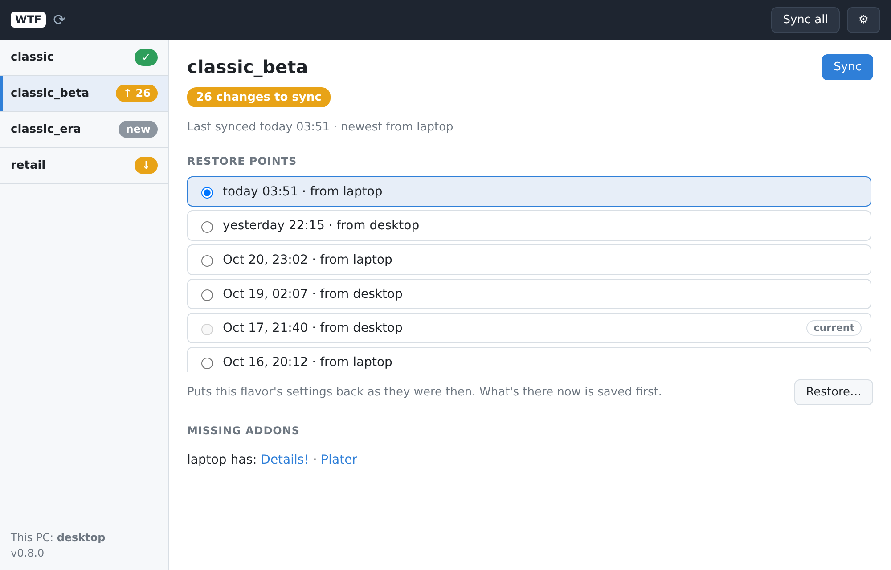
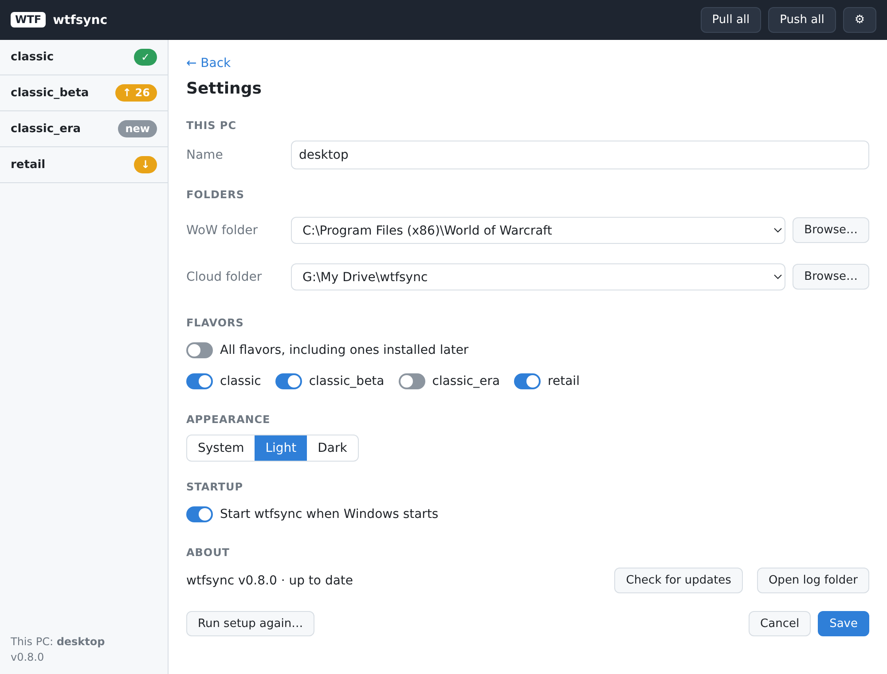
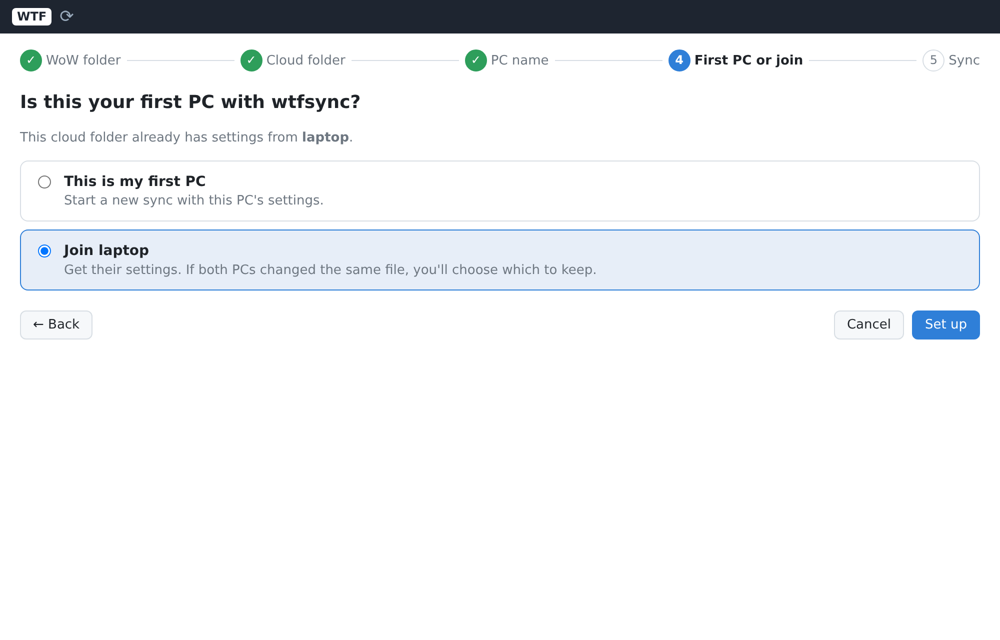
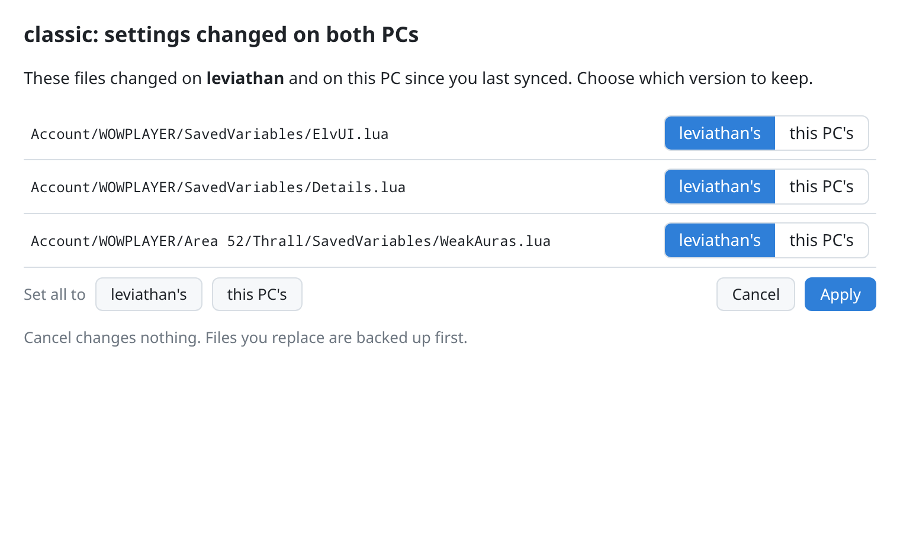
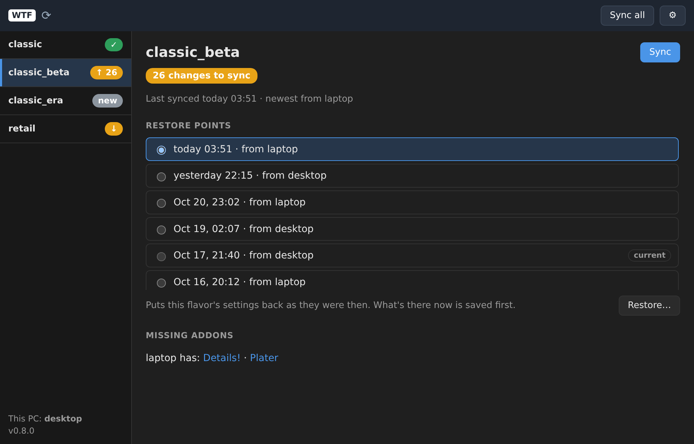

# wtfsync

Sync World of Warcraft addon settings (SavedVariables) between PCs through a folder your cloud
client already syncs (Google Drive for Desktop, OneDrive, iCloud, Dropbox).

It syncs `WTF/Account/**/SavedVariables/*.lua` for every installed flavor (retail, classic, …).
It never touches `Config.wtf` (graphics/hardware settings stay per-PC) or addon code.

It doesn't install addons, but it tells you what you're missing. Each push records the PC's
installed addons, and `pull`, `push` and `status` on the other PC list any it doesn't have, with
a download link when the addon's `.toc` names its CurseForge, Wago or WoWInterface project:

    laptop has addons not installed here:
      Plater  https://www.curseforge.com/projects/100547
      ElvUI (ElvUI, ElvUI_Options)  https://addons.wago.io/addons/…

The settings arrive anyway, so once you install the addon it's already set up.

## Setup

On your first PC:

    wtfsync init

On each other PC (point it at the same cloud folder):

    wtfsync link

To change a PC's WoW folder, cloud folder or name later, run `init` (or `link`) again: your
current answers are the defaults and the PC keeps its identity. Pointing it at a different folder
makes the next sync ask once which settings to use, like a first link.

## Use

Close WoW, then:

    wtfsync push      # after playing
    wtfsync pull      # before playing on the other PC
    wtfsync status    # what's changed, and whether you're behind

If the same addon's settings changed on both PCs, wtfsync asks which one to keep. Every pull backs
up the files it overwrites; `wtfsync restore` puts the newest backup back.

Add `--dry-run` to any command to see what it would do without changing anything.

## Download

Run `wtfsync-setup.exe` from the latest [release](../../releases/latest).
It installs for your Windows user only (no admin prompt) into `%LOCALAPPDATA%\Programs\wtfsync`,
adds a Start menu entry, and can start wtfsync with Windows and add the `wtfsync` command to PATH.
It isn't code-signed yet, so Windows SmartScreen asks once: **More info → Run anyway**. wtfsync's
windows use Microsoft Edge WebView2, which Windows 10 and 11 already include.

The tray app checks for new releases once a day and offers **Update to vX.Y.Z** in its menu.
Uninstalling (Settings → Apps) keeps your settings and backups in `%APPDATA%\wtfsync`.

The release also has `wtfsync.exe` on its own, for using just the command line.

Releases are automatic: every merge to `main` that includes a `feat:`, `fix:`, `perf:` or breaking
change ([Conventional Commits](https://www.conventionalcommits.org/)) publishes a new version. `fix`
bumps the patch number, `feat` the minor, and a breaking change (`feat!:` or a `BREAKING CHANGE:`
footer) the major (the minor while still 0.x). Merges with only `docs:`, `chore:`, `ci:`, `test:` or
`refactor:` commits don't release.

Each release's notes are the changelog: its features, fixes and breaking changes, grouped from the
commit messages, with the PR each came from. See [all releases](../../releases).

## Tray app

`wtfsync-tray.exe` (the Start menu entry) puts a **WTF** icon in the notification area. The strip
along its bottom shows the state:

| Strip | Means |
|---|---|
| green ✓ | every flavor is in sync |
| amber ↓ | another PC pushed newer settings (a notification offers **Pull**) |
| red ! | needs you: an error, a refused sync (close WoW first), a push waiting for the cloud folder, or missing addons |
| blue ⟳ | syncing |

Click the icon to open the wtfsync window; right-click for the menu (Open wtfsync, Push, Pull,
Settings, Update, Open log folder, Quit). Closing the window keeps wtfsync running in the tray.

In the window, pick a WoW flavor on the left to see everything about it: whether it's in sync and
when it last synced, **Pull** and **Push** for just that flavor, its backups (pick one and
**Restore…** — what's there now is backed up first, so a restore can be undone), and addons your
other PCs have that this one doesn't, with download links. **Pull all** and **Push all** are in the
top bar.

**⚙ Settings** has this PC's name, the WoW and cloud folders, which flavors to sync (**All
flavors**, or pick them), Appearance (System, Light or Dark), start with Windows, updates, and
**Run setup again**.

| Settings | Setup |
|---|---|
|  |  |

If the same addon's settings changed on both PCs, a window asks which version to keep, file by
file; Cancel changes nothing.

It follows Windows' light or dark mode unless you pick one in Settings:

The tray and the `wtfsync` command never sync at the same time: whichever starts second says "a
sync is already running".

**Something wrong?** The menu's **Open log folder** opens `%APPDATA%\wtfsync`, which holds:

- `tray.log`: each menu click, window, sync (with how long it took and any error), a health line
  every 10 minutes (memory, CPU, open windows), and Wails' own warnings. A sync still running
  after a minute also logs every goroutine's stack, which shows where a stuck tray is stuck.
- `crash.log`: the full stack trace if the tray crashes.

## Command reference

`wtfsync.exe` is the command line: everything the tray does, scriptable. Close WoW before syncing;
commands that would change files refuse while that flavor's game is running.

### `wtfsync init`

Sets up the first PC: asks for the WoW folder, the cloud folder and a name for this PC, creates
wtfsync's data in the cloud folder, then pushes. Run it again to change any of those answers; the
PC keeps its identity, and pointing it at a different folder clears its sync history.

    wtfsync init
    wtfsync init --sync-dir "G:\My Drive" --name desktop

### `wtfsync link`

Sets up another PC on a cloud folder that already has wtfsync data, then pulls. On a first link,
when both PCs have settings, it asks once whether to use the other PC's for everything, keep this
PC's, or choose per file.

    wtfsync link

### `wtfsync push`

Uploads this PC's addon settings for every enabled flavor as a new snapshot. If another PC pushed
since this one last synced, its changes are merged first. If the cloud folder can't be reached,
the push is kept pending and retried by the next command (or the tray, every minute).

    wtfsync push
    wtfsync push --flavor classic

### `wtfsync pull`

Downloads the newest settings from your other PCs. Files changed only there are taken, files
changed only here are kept, and files changed on both ask which to keep. Every file it overwrites
or deletes is backed up first.

    wtfsync pull
    wtfsync pull --dry-run

### `wtfsync status`

Shows, per flavor, when it last synced, the newest snapshot and who pushed it, how many files
changed here, whether a push is pending, and addons other PCs have that this one doesn't.

    wtfsync status

### `wtfsync restore`

Puts back the files from the newest backup (or an older one with `--set`), backing up what it
replaces first. With `--dry-run` it shows what it would put back and lists the other backups'
ids.

    wtfsync restore --flavor retail --dry-run
    wtfsync restore --flavor retail --set 20261020T035114.000Z

### `wtfsync version`

Prints the version.

### Flags

| Flag | Applies to | Meaning |
|---|---|---|
| `--flavor <name>` | push, pull, status, restore | only this flavor (`retail`, `classic`, …); default: every enabled flavor |
| `--dry-run` | all but version | show what would change; change nothing |
| `--wow-dir <path>` | all but version | WoW install folder (overrides settings) |
| `--sync-dir <path>` | all but version | the cloud-synced folder (overrides settings) |
| `--data-dir <path>` | all but version | wtfsync's local data folder (default `%APPDATA%\wtfsync`) |
| `--name <name>` | init, link | this PC's display name |
| `--set <id>` | restore | which backup to restore (`restore --dry-run` lists the ids) |

### Exit codes

| Code | Means |
|---|---|
| 0 | done |
| 1 | error |
| 2 | refused: WoW is running, a snapshot isn't downloaded from the cloud yet, or another sync is running |
| 3 | a conflict question was cancelled; nothing was changed |

## Build

    .github/scripts/build.sh dev    # needs makensis (apt install nsis)

builds `dist/wtfsync.exe`, `dist/wtfsync-tray.exe`, `dist/wtfsync-setup.exe` and
`dist/checksums.txt`. CI does the same for every PR (artifact `wtfsync-windows-amd64`).
`wtfsync version` prints the version a build was made with.

## Manual test checklist (real PCs)

1. `wtfsync init --dry-run`: the flavors and file list look right.
2. `push` / `pull` with `--wow-dir` pointed at a *copy* of the install.
3. Two PCs syncing through Google Drive for Desktop (including streaming/placeholder mode).
4. Change the same addon on both PCs without syncing: the second push asks.
5. Install `wtfsync-setup.exe`: Start menu entry, tray icon, and the window opening on the setup wizard on a PC that isn't set up.
6. Push on one PC → a notification on the other within a minute → **Pull** from it.
7. Same-file conflict → the conflict window; Cancel leaves files as they were; it appears even while the main window is hidden.
8. WoW running → Pull is refused with "Close WoW (flavor) first".
9. Tray syncing while `wtfsync pull` runs in cmd → "a sync is already running".
10. Settings: rename the PC, All flavors off then a flavor off, start at login (check after a reboot).
11. Update from one release to the next from the tray menu; the tray comes back on its own.
12. Uninstall: programs, shortcut and startup entry gone; `%APPDATA%\wtfsync` still there.
13. Tray left-click opens and focuses the window; closing it hides it; Quit from the menu really quits.
14. Badges on both PCs match reality: ✓, ↑ N after editing a file, ↓ after the other PC pushes, `new` for a flavor never synced.
15. Restore an older backup (not the newest), then restore the "before restore" backup to undo it.
16. Appearance Light / Dark / System, including Windows switching theme while the window is open.
17. An update on offer: the toast shows when the window opens; **Later** hides it until the next version; **Update now** installs and the tray comes back.
